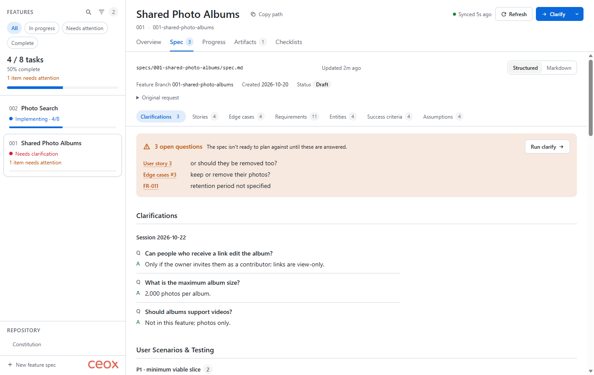
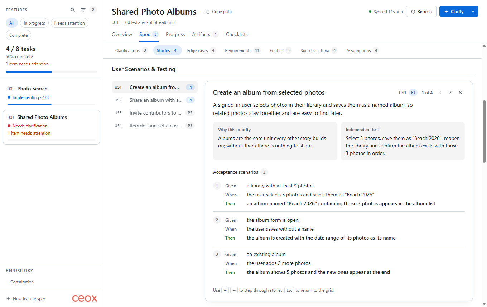

# Spec-kit Canvas

A GitHub Copilot canvas for browsing a repository's [spec-kit](https://github.com/github/spec-kit) features, seeing each spec's pipeline status at a glance, and dispatching the next speckit agent straight into your chat session.



The Spec tab reads `spec.md` as structured sections, here with a user story open in the focus panel:



## What it does

- **Feature board** — every folder under `specs/` as a card with live status, task progress, and attention counts.
- **Pipeline status** — derives where each feature sits in the `specify → clarify → plan → tasks → implement` cycle, plus a computed "next agent" with the reason why.
- **Attention required** — surfaces real, disk-grounded signals: open `[NEEDS CLARIFICATION]` markers, stale plan/tasks artifacts, unchecked checklist criteria, and empty task lists.
- **One-click dispatch** — run the next speckit agent (`speckit.specify`, `speckit.plan`, `speckit.implement`, …) from the canvas; the command is sent to your current Copilot session.
- **Live updates** — watches `specs/` and `.specify/` and pushes state over Server-Sent Events, so the board reflects agent edits in real time.
- **Artifact viewer** — read `spec.md`, `plan.md`, `tasks.md`, research, checklists, and contracts inline with rendered Markdown.
- **Structured spec reader** — the Spec tab parses `spec.md` along the spec-kit template: user stories become browsable tiles grouped by priority with a focus panel (Given/When/Then scenarios, ←/→ to step, Esc to close), requirements and success criteria become filterable ID lists, and entities, edge cases, assumptions and clarification Q&A get their own views. A sticky section map, an open-questions strip, and clickable `FR-`/`SC-`/story cross-references make the file easy to navigate; a Markdown toggle shows the raw text.
- **Repository constitution** — read `.specify/memory/constitution.md` from the sidebar's Repository section, separately from feature artifacts, even when there are no specs. The read-only view updates live and preserves your selected feature and tab.

Everything shown is derived from files on disk — no invented metrics.

## Files

- `plugin.json` — plugin manifest used by the extension marketplace and website.
- `.github/plugin/marketplace.json` — marketplace catalog for discovering and installing the plugin in Copilot.
- `assets/preview.png`, `assets/spec-reader.png` — gallery preview and structured spec reader screenshots.
- `.github/github-app.yml` — Copilot app repository config: agent instructions plus **Run canvas** and **Test** scripts.
- `extensions/speckit-canvas/extension.mjs` — Copilot SDK entry point: registers the canvas, its actions, and the session bridge.
- `extensions/speckit-canvas/server.mjs` — SDK-free loopback server: API routes, static files, SSE, and file watching.
- `extensions/speckit-canvas/dev.mjs` — standalone local runner for manual verification (see [Run locally](#run-locally)).
- `extensions/speckit-canvas/dev/demo-repo/` — demo spec-kit repository used by the local runner.
- `extensions/speckit-canvas/speckit.mjs` — the scanner: parses specs/tasks/checklists, derives status, health, phases, and attention items.
- `extensions/speckit-canvas/public/` — the canvas UI (`index.html`, `styles.css`, `app.js`, plus `spec-parser.js` and `spec-view.js` for the structured spec reader).
- `extensions/speckit-canvas/copilot-extension.json` — Copilot extension name/version metadata.
- `extensions/speckit-canvas/package.json` — extension metadata for cataloging and packaging.

## Install

### GitHub Copilot app (recommended)

Register the marketplace and install the plugin using the Copilot CLI with the same user/configuration as the app:

```powershell
copilot plugin marketplace add CeoxServicesLtd/speckit-canvas
copilot plugin install speckit-canvas@ceox-speckit
```

The registered marketplace can then be browsed in the app's **Customize → Plugins** view. This installs the canvas as a managed plugin rather than copying a standalone extension.

Restart the app/session or reload extensions, then open **Spec-kit board** (canvas ID `speckit-canvas`).

If you previously installed a standalone copy under `~/.copilot/extensions/speckit-board/`, `~/.copilot/extensions/speckit-canvas/`, or `.github/extensions/`, move that specific extension folder outside the extensions directory after installing the plugin. Keep a backup until the plugin works. Do not leave both copies enabled: they register the same board. This migration does not change your repository's specs or constitution.

### Direct repository installation

If you do not need marketplace discovery:

```powershell
copilot plugin install CeoxServicesLtd/speckit-canvas
```

Use either the marketplace installation or the direct installation, not both.

## Updates and releases

The board checks GitHub's latest published stable release when opened and hourly while open. Its sidebar footer shows the running version, any available update, and a **Check for updates** button beside the Ceox logo. Checks are cached for an hour across panels; the button forces a fresh check. Pre-releases and draft releases are not offered. Network/API errors are shown in the sidebar and can be retried.

Choose **Update to v...**, then **Confirm update** to install only the displayed published release. **Not now** or Escape cancels without installing anything. Before installation, the updater rechecks that the release is still published and unchanged, fetches only its explicit Git tag (never a branch), and verifies that the plugin and extension manifests match that release's version. It then uses Copilot's local plugin installer and verifies the installed version matches exactly; a newer, unpublished version is not accepted. Network, download, manifest, and installation errors stop the update without falling back to the default branch.

Copilot's `plugin update` command is deliberately not used: it follows the source's default branch rather than published releases. Release updates instead use a direct installation from a retained, release-pinned checkout under `COPILOT_HOME/release-cache/speckit-canvas/` (default `~/.copilot/release-cache/speckit-canvas/`). If the running copy was marketplace-installed, the confirmation explains that it will be replaced by a direct release installation and the marketplace copy disabled, not uninstalled, to avoid duplicate canvases. The marketplace remains registered. Subsequent board updates continue to use published releases only.

After an update, reload extensions or restart the app/session and reopen the board. The updater never restarts the app automatically or changes your specs. The standalone development server checks releases but does not install updates. Git and the Copilot CLI must be available on PATH. A missing, ambiguous, or unsupported managed installation produces an error rather than installing elsewhere.

Release tags must be stable semantic versions such as `v1.3.0` or `1.3.0`, with matching version metadata in the tagged commit. For each release, keep `plugin.json`, `.github/plugin/marketplace.json` (catalog and plugin entry), and `extensions/speckit-canvas/package.json` versions in sync before tagging and publishing the GitHub release. The numeric `version` in `copilot-extension.json` is extension metadata, not the plugin's semantic release version. A tag without a published GitHub release does not trigger an update. The check uses GitHub's public API without credentials and may be rate-limited.

The initial marketplace/direct repository installation above follows the default branch; it is not the release updater. To stay release-only after installation, use the board's confirmed updates, do not manually run `copilot plugin update` against the repository/marketplace source, and do not opt `ceox-speckit` into Copilot CLI's separate session-start `autoUpdate` setting. See the [plugin reference](https://docs.github.com/en/copilot/reference/copilot-cli-reference/cli-plugin-reference).

## Plugin packaging and development

This is a **legacy Copilot plugin** intentionally: its root manifest omits the Agent Plugins `$schema` and uses `"extensions": "extensions"` to discover the existing canvas extension. In Agent Plugins 1.0, `extensions` instead means a namespaced metadata object, so adding that schema without migrating the component layout would break discovery. No separate npm installation or build is required; Copilot supplies the extension SDK.

To inspect the local checkout without installing it:

```powershell
copilot --plugin-dir . plugin list
```

Run the regression and packaging checks:

```powershell
npm --prefix extensions/speckit-canvas test
```

### Run locally

`dev.mjs` serves the canvas UI in an ordinary browser without the Copilot app or SDK (Node 22+, no `npm install` needed):

```powershell
npm --prefix extensions/speckit-canvas run dev
# → Local: http://127.0.0.1:4317/
```

By default it serves a throwaway copy of `dev/demo-repo` (two features: one with open clarifications, stories, requirements and entities; one mid-implementation), so edits and "make active" writes never touch the committed fixture. Edit files in the printed temp folder to watch live updates. Agent dispatches print the prompt to the terminal instead of sending it to a session.

Options: `--repo <path>` serves a real spec-kit repository instead (its `specs/` files are watched in place), `--port <n>` (default `PORT` or `4317`), `--host <addr>`. Example:

```powershell
node extensions/speckit-canvas/dev.mjs --repo C:\path\to\your-speckit-repo --port 4400
```

In the GitHub Copilot app, `.github/github-app.yml` exposes this as the **Run canvas** script (and **Test** for the suite). The app detects the `Local:` URL and opens it in the browser.

## Usage

Open the canvas in a repository that uses spec-kit (a `specs/` directory and `.specify/` config). The board scans automatically. Select a feature to inspect it, then use the primary action button (or the Actions menu) to dispatch the next agent. Keyboard: `j`/`k` or arrow keys move between features, `/` focuses search, `Ctrl+Enter` runs the agent, `Esc` closes dialogs.

Use **New feature spec** immediately below the discovered features in the sidebar to start a new spec. It scrolls with the feature list; the repository section and version/update footer remain at the bottom.

Select **Constitution** under **Repository** in the sidebar to view the global project principles. Use **Back to features** (or `Esc`) to return to the feature view. If the constitution is absent, the viewer shows its expected location rather than adding it to a feature's artifacts.

## Agent actions

- `refresh` — re-scan the specs folder and push the latest state to the canvas.
- `get_status { feature? }` — return the pipeline status for one feature or all features.
- `focus_feature { feature }` — select a feature in the canvas and set it as the active spec-kit feature.

## Requirements

- GitHub Copilot CLI with extension/canvas support.
- A repository using [spec-kit](https://github.com/github/spec-kit) (`specs/` + `.specify/`).
